# Cone

**Juxtopposed's VLC Redesign, working for real on VLC 4.** Cone is VLC media player with her whole redesign built on top: new player, sidebars, library, settings and onboarding. Same VLC engine underneath, under its own name so it can sit next to your regular VLC.

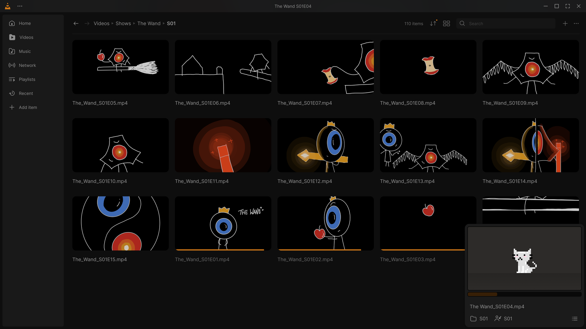

<sub>This image is a frame of Juxtopposed's Figma design, which Cone implements. Screenshots of Cone itself go in the gallery below.</sub>

**Status:** pre-release. Most of the design is coded; it's being checked screen by screen against the Figma file on real Windows builds, and only checked code goes into the main branch. Expect rough edges: Cone tracks VLC 4 development code. Live progress: [redesign/STATUS.md](redesign/STATUS.md).

## Download

**First release: not out yet.** It will be on the [Releases page](https://github.com/Pyr0zen/vlc-redesign-juxtopposed/releases).

- **Portable zip** (Windows 10 / 11, 64-bit): comes first. Unzip anywhere and run `Cone.exe`. <!-- link: first release -->
- **Installer**: later, after it's been tested next to an installed VLC.

Want to try it before that? Every push builds a test package: open the
[build-windows workflow](https://github.com/Pyr0zen/vlc-redesign-juxtopposed/actions/workflows/build-windows.yml),
pick the latest green run and download `vlc-redesign-win64-public` (needs a GitHub login).

## Features

Grouped by screen. Everything runs on VLC's real data and engine.

**Player**
- Thin control bar with a thick seek bar, play button with previous / next around it, cone volume up to 200 %
- Bars float over the video: they fade out in a window and show per edge in fullscreen; Hide UI with `Ctrl+\`
- Seek preview thumbnails while hovering, click-to-type time, resume prompt
- Optional waveform on the seek bar, Ctrl+B for an instant bookmark

**Tracks popup**
- Subtitles, Audio and Video tabs with embedded and external tracks and output devices
- Add Subtitles dialog: a file, a folder or a playlist, from your PC or OpenSubtitles, with episode auto-matching

**Settings sidebar**
- Playback, Video, Audio and Subtitles tabs: speed, sleep timer, flip / rotate / zoom / crop, equalizer presets and filters, subtitle sync sliders and appearance
- Per-show presets that cover all four tabs, and default audio and subtitle languages

**Queue sidebar**
- Queue, Bookmarks and Chapters tabs

**Menus**
- Main "..." menu and a cleaned-up right-click menu, both wired to VLC's real actions

**Library**
- Icon rail, a compact panel over the video and a full-window library
- Home with Continue Watching and Latest Streams, Videos, Music (songs, albums, artists, genres, music player view), Network streams, Playlists, Recent, pins, watched / unwatched sorting
- Mini player with its attached queue, draggable to any corner

**Settings, dialogs and customizing**
- Settings dialog with 13 categories mapped to VLC's own options, search and info popovers
- Keyboard Shortcuts and Open Network Stream dialogs
- Customize Player and profiles (layouts and settings per profile)
- Onboarding: media folder, theme and accent color with live recolor, shortcuts
- Dark and Light themes, 9 accent colors

**Not built yet:** the subtitle timeline on the seek bar and on-screen messages that show the pressed shortcut. Reverse playback is postponed.

## Screenshots

Real Cone screenshots land here as each screen is verified.

<!-- Put real build screenshots in docs/images/cone-*.png and replace each placeholder below. -->

| | |
|---|---|
| **Player**<br>*screenshot coming* | **Home**<br>*screenshot coming* |
| **Library and mini player**<br>*screenshot coming* | **Settings sidebar**<br>*screenshot coming* |
| **Settings**<br>*screenshot coming* | **Onboarding**<br>*screenshot coming* |

### The design being built

Juxtopposed's Figma frames, the source for every size, color and spacing in Cone.

| | |
|---|---|
| **Player**<br>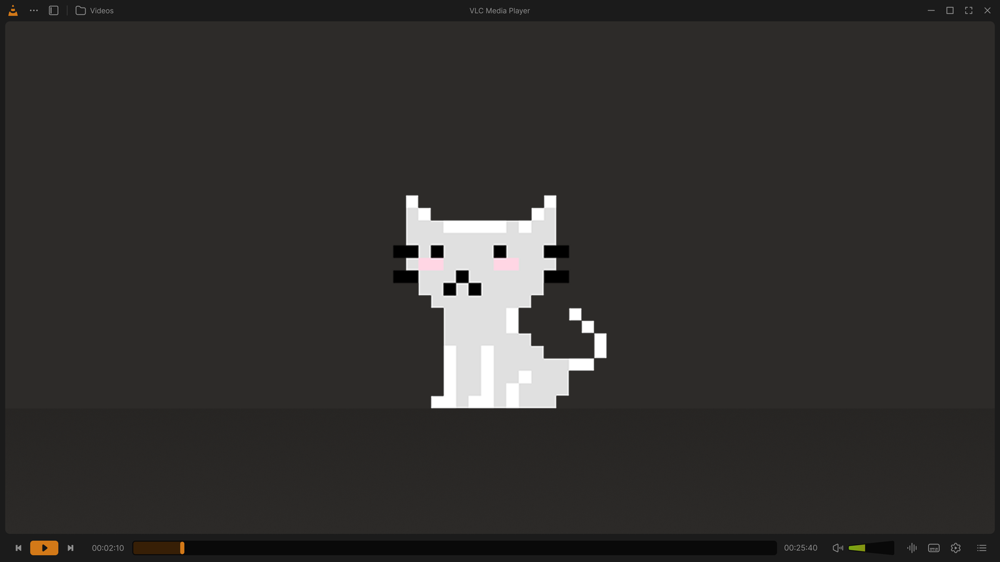 | **Home**<br>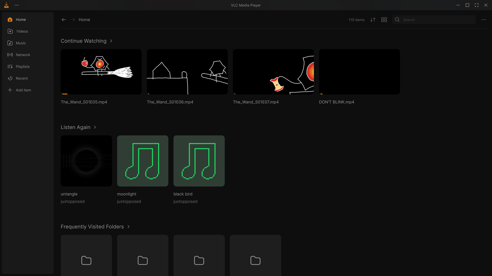 |
| **Library and mini player**<br>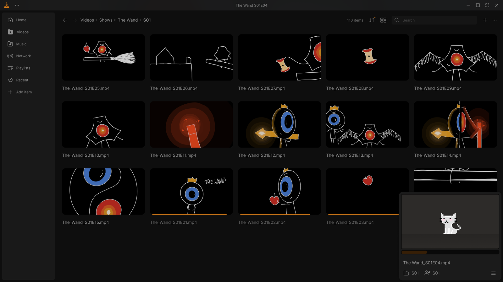 | **Compact library**<br>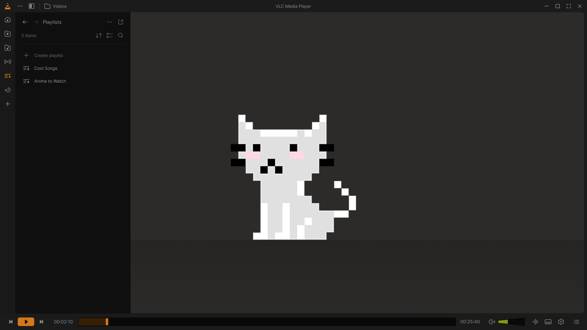 |
| **Settings**<br>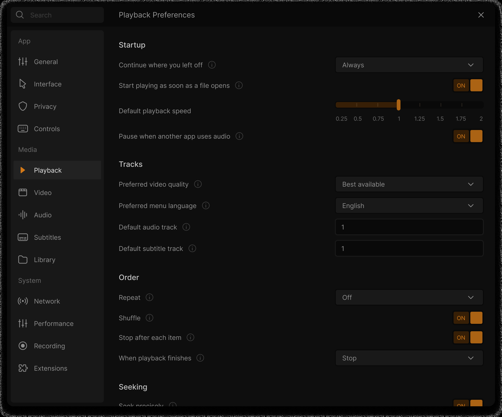 | **Customize Player**<br>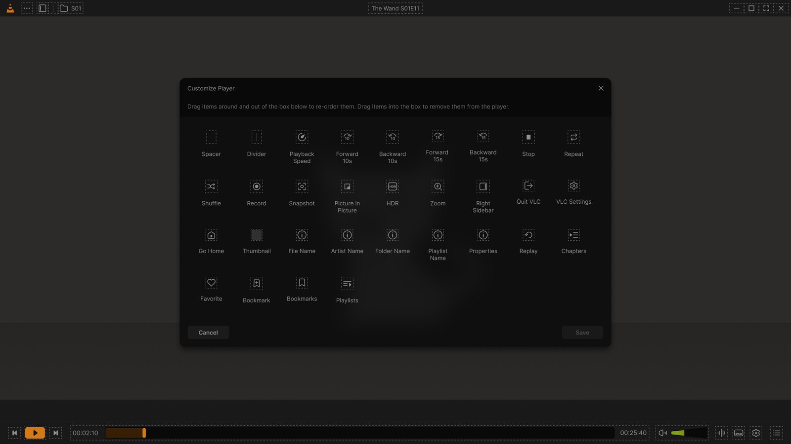 |
| **Onboarding**<br>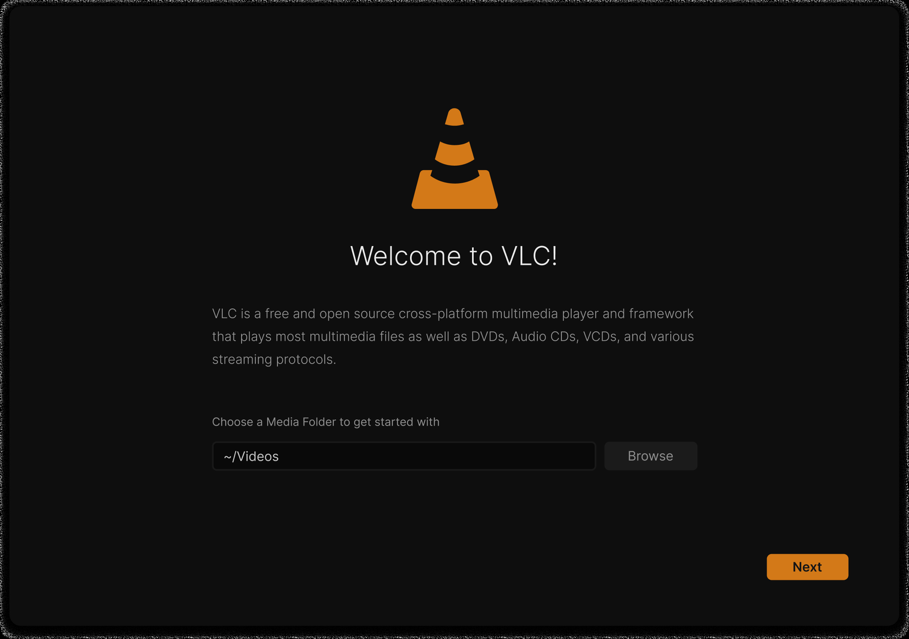 | **Keyboard Shortcuts**<br>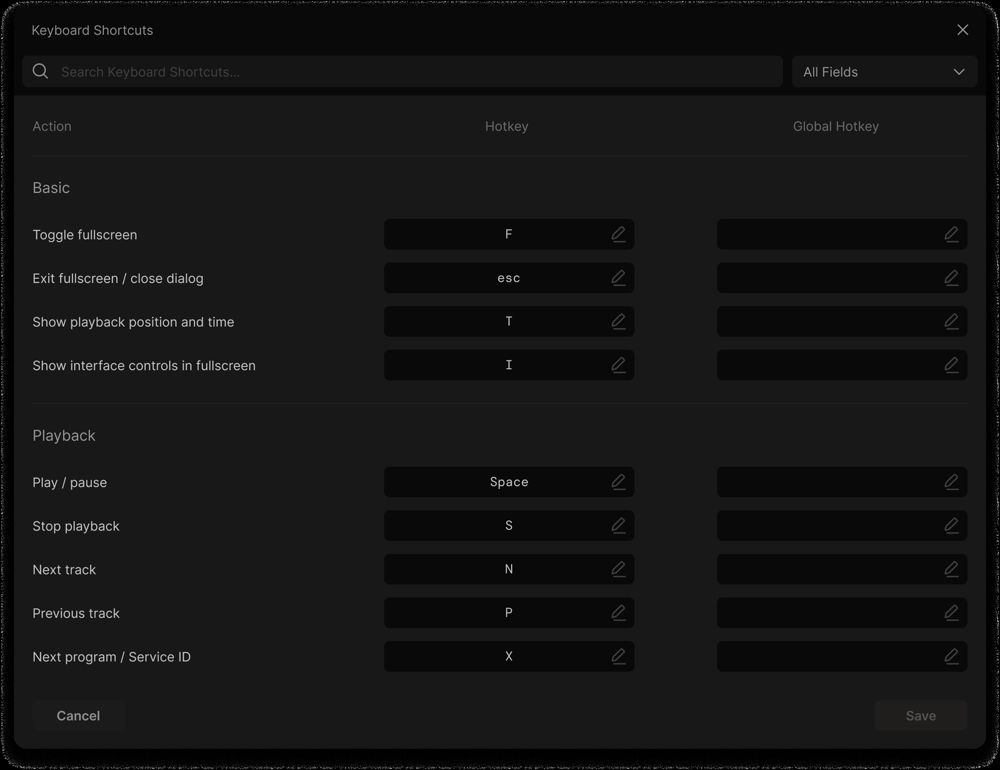 |
| **Light theme**<br>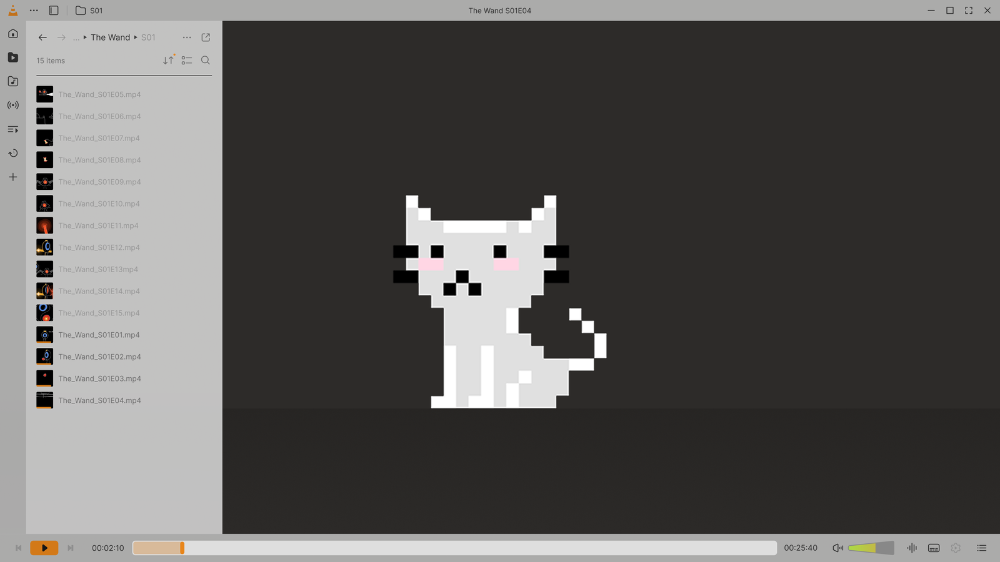 | |

<p align="center">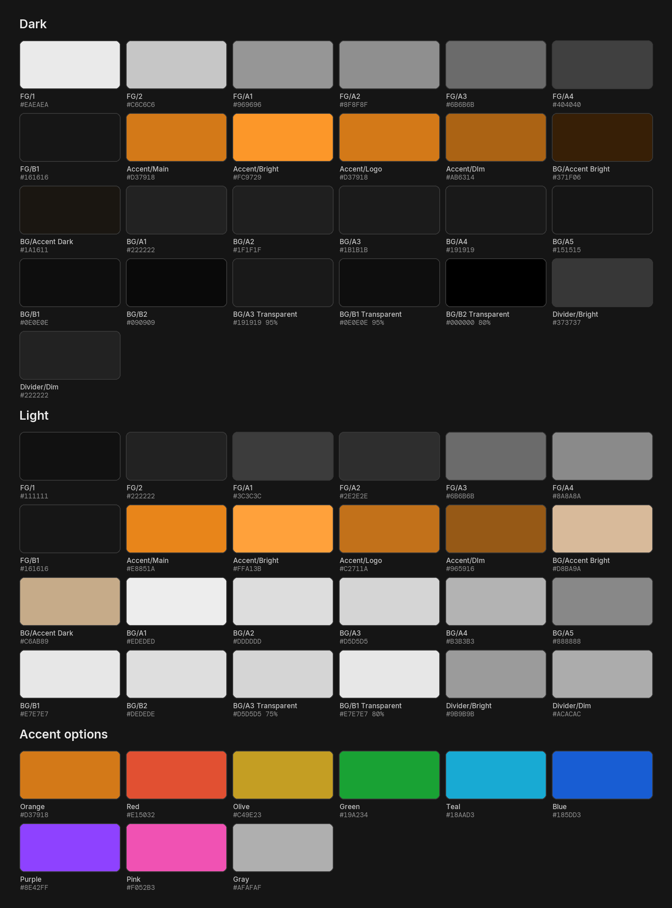 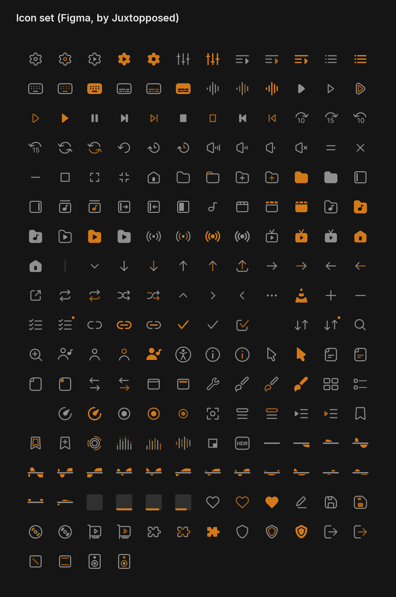</p>

## FAQ

**Why "Cone" and not VLC?**
"VLC" and the traffic cone icon are VideoLAN's trademarks, so this build ships under its own name and icon. Under the hood it's VLC.

**Is it official?**
No. Cone isn't affiliated with, endorsed or sponsored by VideoLAN or by Juxtopposed.

**Can I keep my regular VLC installed?**
Yes, that's the idea. Cone keeps its own settings and library in `%APPDATA%\Cone`, has its own entry in the volume mixer and never hands files to a running VLC. The installer (later) starts with the file associations unticked when VLC is installed.

**Does it change how media plays?**
No. Playback, codecs and the engine are VLC's own. The work is in VLC's Qt interface (`modules/gui/qt`); the few small core changes a feature truly needs are kept separate and listed in `redesign/VIDEO_INDEX.md`.

**Does it update itself?**
No, there's no update checker. New versions show up on the Releases page.

**Is it as fast as stock VLC?**
That's the first rule of the project, measured against stock VLC 4 on the same PC ([redesign/PERF.md](redesign/PERF.md)). Latest round: startup about 1 s for both, playing at 0.1 % CPU and about 310 MB RAM for both, 4K60 at 80 Mbit/s with the same dropped frames as stock, and a 520-item queue that scrolls at least as smoothly.

**Mac or Linux?**
Windows only for now.

**How was it made?**
With Claude Code, working from the Figma file (sizes, colors and spacing taken from its node values) and the designer's video for behavior. Each screen is checked with real screenshots of the build next to the Figma frames.

## How to build

The build runs on GitHub Actions with VideoLAN's own Windows toolchain image and build script (`extras/package/win32/build.sh`), the same as VLC's official win64 CI job. To build your own: fork this repository, enable Actions on the fork and run the **build-windows** workflow (`.github/workflows/build-windows.yml`) with the brand set to `public`; the artifact is a ready-to-run Cone folder. Building VLC itself is documented on the [VideoLAN wiki](https://wiki.videolan.org/Win32Compile/).

## Credits

- **Design:** ["VLC Redesign" by Juxtopposed](https://www.figma.com/community/file/1691465999134370980/vlc-redesign) ([video](https://youtu.be/ERFeOgqk324)), used under [CC BY 4.0](https://creativecommons.org/licenses/by/4.0/). Changes were made to adapt it to VLC.
- **Based on VLC media player** by VideoLAN and its contributors, GPLv2 or later (libVLC LGPLv2 or later). Cone is GPLv2 or later too, and all of its source is here.
- **Fonts:** Inter and DM Mono, SIL Open Font License.
- **Built by StickyGonzales** ([Pyr0zen](https://github.com/Pyr0zen) on GitHub).

Cone is an independent project, not affiliated with VideoLAN or Juxtopposed. Details in [CREDITS.md](CREDITS.md).

---

# About VLC

*VideoLAN's original README follows.*

# VLC media player

**VLC** is a libre and open source **media player** and **multimedia engine**,
focused on **playing everything**, and **running everywhere**.

**VLC** can play most multimedia files, discs, streams, devices and is also able to
convert, encode, **stream** and manipulate streams into numerous formats.

VLC is used by many over the world, on numerous platforms, for very different use cases.

The **engine of VLC** can be embedded into 3rd party applications, and is called *libVLC*.

**VLC** is part of the [VideoLAN project](https://videolan.org) and
is developed and supported by a community of volunteers.

The VideoLAN project was started at the university [École Centrale Paris](https://www.centralesupelec.fr/) who
relicensed VLC under the GPLv2 license in February 2001. Since then, VLC has
been downloaded **billions** of times.

## License

**VLC** is released under the GPLv2 *(or later)* license.
*On some platforms, it is de facto GPLv3, because of the licenses of dependencies*.

**libVLC**, the engine is released under the LGPLv2 *(or later)* license. \
This allows embedding the engine in 3rd party applications, while letting them to be licensed under other licenses.

# Platforms

VLC is available for the following platforms:
- [Windows] *(from 7 and later, including UWP platforms and all versions of Windows 10)*
- [macOS] *(10.10 and later)*
- [GNU/Linux] and affiliated
- [BSD] and affiliated
- [Android] *(4.2 and later)*, including Android TV and Android Auto
- [iOS] *(9 and later)*, including AppleTV and iPadOS
- Haiku, OS/2 and a few others.

[Windows]: https://www.videolan.org/vlc/download-windows.html
[macOS]: https://www.videolan.org/vlc/download-macosx.html
[GNU/Linux]: https://www.videolan.org/vlc/#download
[BSD]: https://www.videolan.org/vlc/download-freebsd.html
[Android]: https://www.videolan.org/vlc/download-android.html
[iOS]: https://www.videolan.org/vlc/download-ios.html

Not all platforms receive the same amount of care, due to our limited resources.

**Nota Bene**: The [Android app](https://code.videolan.org/videolan/vlc-android/) and
the [iOS app](https://code.videolan.org/videolan/vlc-ios/) are located in different repositories
than the main one.

# Contributing & Community

**VLC** is maintained by a community of people, and VideoLAN is not paying any of them.\
The community is composed of developers, helpers, maintainers, designers and writers that want
this open source project to thrive.

The main development of VLC is done in the C language, but this repository also contains
plenty of C++, Obj-C, asm and Rust.

Other repositories linked to vlc are done in languages including Kotlin/Java [(Android)](https://code.videolan.org/videolan/vlc-android/),
Swift [(iOS)](https://code.videolan.org/videolan/vlc-ios/), and C# [(libVLCSharp)](https://code.videolan.org/videolan/libvlcsharp/).

We need help with the following tasks:
- Coding
- Packaging for Windows, macOS and Linux distributions
- Technical writing for the documentation
- Design
- Support
- Community management and communication.

Please contribute :)

We are on IRC. You can find us on the **#videolan** channel on *[Libera.chat]*.

[Libera.chat]: https://libera.chat

## Contributions

Contributions are now done through Merge Requests on our [GitLab repository](https://code.videolan.org/videolan/vlc/).

CI and discussions should be resolved before a Merge Request can be merged.

# libVLC

**libVLC** is an embeddable engine for 3rd party applications and frameworks.

It runs on the same platforms as VLC *(and sometimes on more)* and can provide playback,
streaming and conversion of multimedia files and streams.


**libVLC** has numerous bindings for other languages, such as C++, Python and C#.

# Support

## Links

Some useful links that might help you:

- [VLC web site](https://www.videolan.org/vlc/)
- [Support](https://www.videolan.org/support/)
- [Forums](https://forum.videolan.org/)
- [Wiki](https://wiki.videolan.org/)
- [Developer's Corner](https://wiki.videolan.org/Developers_Corner)
- [VLC hacking guide](https://wiki.videolan.org/Hacker_Guide)
- [Bugtracker](https://code.videolan.org/videolan/vlc/-/issues)
- [VideoLAN web site](https://www.videolan.org/)

## Source Code sitemap
```
ABOUT-NLS          - Notes on the Free Translation Project.
AUTHORS            - VLC authors.
COPYING            - The GPL license.
COPYING.LIB        - The LGPL license.
INSTALL            - Installation and building instructions.
NEWS               - Important modifications between the releases.
README             - Project summary.
THANKS             - VLC contributors.

bin/               - VLC binaries.
bindings/          - libVLC bindings to other languages.
compat/            - compatibility library for operating systems missing
                     essential functionalities.
contrib/           - Facilities for retrieving external libraries and building
                     them for systems that don't have the right versions.
doc/               - Miscellaneous documentation.
extras/analyser    - Code analyser and editor specific files.
extras/buildsystem - Different build system specific files.
extras/misc        - Files that don't fit in the other extras/ categories.
extras/package     - VLC packaging specific files such as spec files.
extras/tools/      - Facilities for retrieving external building tools needed
                     for systems that don't have the right versions.
include/           - Header files.
lib/               - libVLC source code.
modules/           - VLC plugins and modules. Most of the code is here.
po/                - VLC translations.
share/             - Common resource files.
src/               - libvlccore source code.
test/              - Testing system.
```
