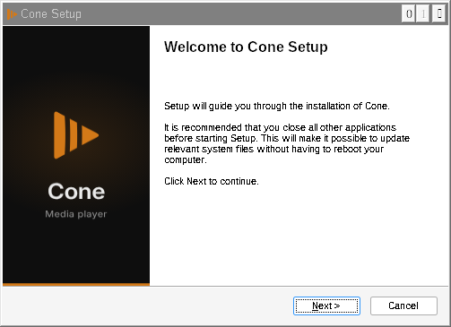
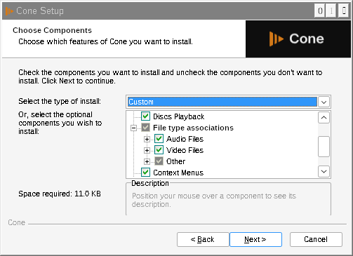
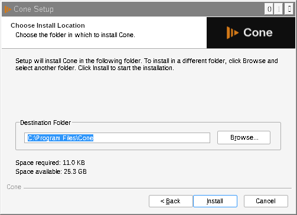
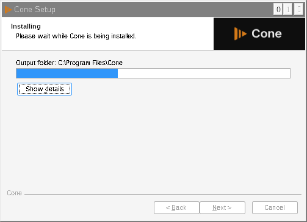
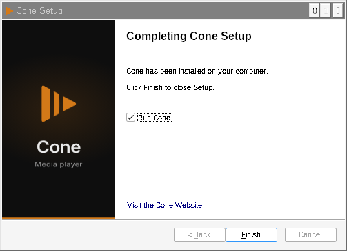
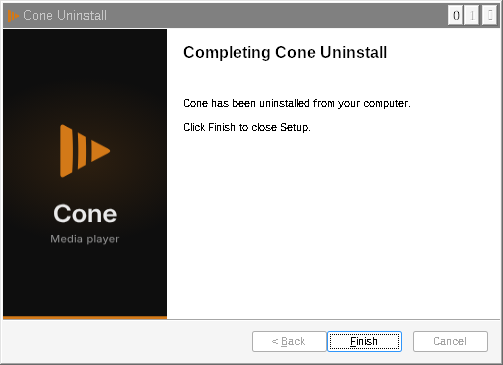

# Cone release: side by side with VLC (branch wip/cone-release)

Status: code done, **nothing verified on Windows**. Checked here only with makensis and Wine (see "Checks done here").
Everything below applies to the **public** brand profile only. The **vlc** profile builds exactly what it built before (how that was checked is under "Checks done here").

## 1. What changed

| # | Area | What Cone does now | Files | Commit |
|---|------|--------------------|-------|--------|
| 1 | Settings and data folder | `%APPDATA%\Cone` for vlcrc, media library, art cache, Lua and skins user data, the redesign's own files and crash dumps. Qt interface settings `%APPDATA%\Cone\vlc-qt-interface.ini` (Qt organization "Cone"; VLC keeps `%APPDATA%\vlc\vlc-qt-interface.ini`). Interface language in `HKCU\Software\Cone` (Lang). | `src/win32/dirs.c` (core), `bin/winvlc.c`, `modules/gui/qt/util/brand.hpp`, `qt.cpp`, `dialogs/sout/profile_selector.cpp`, `dialogs/redesign/settings/settings_catalog.cpp`, `dialogs/preferences/simple_preferences.cpp` | 254361a596 |
| 2 | Updates | No update checker and no update notice. `build.sh -B public` no longer passes `--enable-update-check`; configure and meson refuse the update check with the public brand. | `extras/package/win32/build.sh`, `configure.ac`, `meson.build` | fa02c8ccb8 |
| 3a | NSIS installer | Own ProgIDs `Cone.<ext>`, verbs `PlayWithCone` / `AddToPlaylistCone` (also on Directory, AudioCD, DVD), autoplay handlers `ConePlay*OnArrival`, ProgIDs `Cone.DVDMovie` etc., default programs entry `Software\Clients\Media\Cone` + RegisteredApplications "Cone", backup value `Cone.backup`, install key `HKLM\Software\Cone`, uninstall key `...\Uninstall\Cone`, App Paths `Cone.exe`, install folder `Program Files\Cone`, file name `cone-<version>-win64.exe`. The uninstaller removes only Cone's keys and `%APPDATA%\Cone`, and no longer touches VLC's old Mozilla plugin files and key. | `extras/package/win32/NSIS/vlc.win32.nsi.in`, `helpers/extensions.nsh`, `helpers/utils.nsh`, `spad.nsi.in`, `NSIS/meson.build`, `configure.ac` / `meson.build` (new `BRAND_PROGID`) | 40cd7e9d65 |
| 3b | MSI | Own product name, company, exe and icon, ProgIDs, registry keys, a new UpgradeCode and new component GUIDs (so it never upgrades, removes or shares components with VLC's MSI), looks for Cone's NSIS install (not VLC's) before installing, file name `cone-<version>-win64.msi`. | `extras/package/win32/msi/config.wxi.in`, `product.wxs`, `extensions.wxs`, `msi/meson.build`, `msi.mak` | 70e74426a4 |
| 3c | Installer look and wording | Cone images and texts, see section 2. The Cone uninstaller also removes the Blu-ray autoplay handler (VLC's uninstaller forgets it). | `extras/package/win32/brand/public/*.bmp`, `installer-art.js`, `NSIS/brand-languages.sh`, `vlc.win32.nsi.in`, `package.mak`, `NSIS/meson.build`, MSI files | 03580142e9 |
| 4 | Preferences file associations | The old preferences' association list and its Default Programs button used VLC's ProgIDs and install key (would have pointed file types at an installed VLC). Now Cone's. | `util/brand.hpp`, `dialogs/preferences/simple_preferences.cpp` | 146d6f00c7 |
| 5 | CI | A public build also builds `cone-<version>-win64.exe` and uploads it as the artifact **cone-installer-win64** (test only; this step cannot fail the build). | `.github/workflows/build-windows.yml` | 2ca74d52d6 |

Core change: `src/win32/dirs.c` (one `#define` for the folder name). Per the build rounds rule it should go in its own build.

"Local app data equivalent": VLC itself keeps nothing in `%LOCALAPPDATA%`. The only thing there is Qt's own cache, which Qt names after the exe: `%LOCALAPPDATA%\Cone` for Cone.exe, `%LOCALAPPDATA%\vlc` for vlc.exe. So it is already separate and needed no change.

## 2. Installer look

Bitmaps (exact size, 24-bit BMP, made by `extras/package/win32/brand/public/installer-art.js`): background Dark/BG/B1 #0E0E0E, the Cone logo in #D37918, Inter SemiBold "Cone" in Dark/FG/1 #EAEAEA, "Media player" in Dark/FG/A1 #969696, a 3 px accent line at the bottom of the side image. No VLC cone anywhere.

| Welcome / finish side image (164 x 314) | Page header image (150 x 57) |
|---|---|
|  |  |

| MSI banner (493 x 58; WiX draws the black title over the white left part) |
|---|
|  |

| MSI welcome / exit dialog image (493 x 312; WiX draws the text right of the dark panel) |
|---|
|  |

Wording: every installer and uninstaller text names Cone. The window titles are "Cone Setup" / "Cone Uninstall", the branding line is "Cone", the finish link is "Visit the Cone Website" (project page), and the shortcuts are "Cone", "Cone skinned", "Cone Website", "Documentation" (project README) and "Cone - reset preferences and cache files". The 35 translations are rewritten at packaging time by `brand-languages.sh` (VLC / VideoLAN become Cone; string IDs untouched).

Page order and behavior are unchanged: language, welcome, (already installed), license, components, folder, install, finish; uninstaller: confirm, components, uninstall, finish.

### The real Cone installer pages

Screenshots of the real NSIS installer built from this branch, run under **Wine** in this cloud session with a stub payload (dummy files, so the license text is an "x" and the sizes are tiny). Wine draws its own title bars, fonts and controls, so Windows 10 will look a little different (Segoe UI, Windows title bar); the images, layout and texts are the real ones.

| | |
|---|---|
| Language  | Welcome  |
| Already installed (second run)  | License  |
| Components  | Install folder  |
| Installing  | Finish  |

Uninstaller:

| | |
|---|---|
| Confirm  | Components  |
| Uninstalling  | Finish  |

The MSI pages could not be rendered here (no WiX toolset), only its two bitmaps above.

## 3. How to test (on the PC)

**Get the builds**
1. GitHub, Actions tab, "build-windows", "Run workflow", branch `wip/cone-release`, brand `public`, Run.
2. When it is green, open the run and download **cone-installer-win64** (the installer) and **vlc-redesign-win64-public** (the zip).
3. If the cone-installer-win64 artifact is missing, the installer step failed (it is allowed to fail): open its log. Testing the settings part (steps 7 to 9) still works with the zip.

**Before**
4. Have the normal VLC installed (from videolan.org). Open it once, change one visible setting (for example Tools, Preferences, Interface language, or a hotkey), close it.
5. Note what opens `.mp4` and `.mkv` (right click a file, Open with) and that "VLC media player" is listed in Settings, Apps, Default apps.

**Install Cone next to it**
6. Run `cone-<version>-win64.exe`. Check every page shows Cone (images, titles, texts) and no VLC cone. Keep the default components.
7. Check: `C:\Program Files\Cone` exists and `C:\Program Files\VideoLAN\VLC` is untouched; Start menu has a "Sticky" folder with Cone's shortcuts and VLC's "VideoLAN" folder is still there; Settings, Apps lists both "VLC media player" and "Cone"; Default apps lists both.
8. Start Cone, change a setting, close it. Start VLC: VLC still has its own setting from step 4 and not Cone's. Start Cone again: it still has its own.
9. Check the folders: `%APPDATA%\vlc` (VLC's) and `%APPDATA%\Cone` (Cone's) both exist; the media library and art cache of each stay in its own folder. In `regedit`: `HKCU\Software\VideoLAN\VLC` (VLC's language) and `HKCU\Software\Cone` (Cone's) are separate.
10. Right click an `.mp4`: there are separate "Play with VLC media player" and "Play with Cone" entries (if VLC's context menus were installed). Note: like VLC's installer, Cone's takes the file associations ticked on the components page. Windows 10 and 11 keep your own default app choice anyway.
11. Check for updates: Cone has no update menu entry and never shows an update notice.

**Uninstall Cone**
12. Settings, Apps, Cone, Uninstall (optionally tick "Delete preferences and cache").
13. Check: VLC still starts with its settings, `%APPDATA%\vlc` is untouched, `C:\Program Files\VideoLAN\VLC` is untouched, `.mp4` opens with VLC again (if it did before), VLC's context menu entries and its Default apps entry are still there, and nothing named Cone is left in `C:\Program Files`, the Start menu, Settings, Apps, or `HKLM\Software\Cone`.

**Your portable test folder** (`<TEST_MEDIA_DIR>\builds\current`): a public build now keeps the Qt interface settings in `portable\Cone\vlc-qt-interface.ini` instead of `portable\vlc\vlc-qt-interface.ini` (vlcrc and the rest stay in `portable`). To keep the old interface settings, copy that one file over once, with the test VLC closed:

```powershell
$p = "<TEST_MEDIA_DIR>\builds\current\portable"; New-Item -ItemType Directory -Force "$p\Cone" | Out-Null; Copy-Item "$p\vlc\vlc-qt-interface.ini" "$p\Cone\vlc-qt-interface.ini"
```

## 4. Checks done here (not verification)

- `buildlists.py` and `privacycheck.py`: 0 problems before every push.
- makensis 3.09: both profiles' installers and `spad.nsi` compile (the same 67 missing-translation warnings as before).
- vlc profile unchanged: its preprocessed NSIS script (`makensis -PPO`) is identical to the one from origin/redesign (only NSIS's line-number labels differ). With the vlc values, `product.wxs` and `extensions.wxs` expand to exactly the old files. The configure / meson flags of the vlc profile are the same strings as before.
- Wine (stub payload, vlc-profile installer as "the installed VLC"):
  - VLC installed, then Cone installed, then Cone uninstalled: HKLM\Software and HKCR are identical to the VLC-only state. `.mp4` was `VLC.mp4`, became `Cone.mp4` with `Cone.backup = VLC.mp4`, and went back to `VLC.mp4`.
  - Cone installed, then VLC uninstalled: no Cone key or value was removed.
- C++: the changed lines were syntax-checked in isolation only; the Qt module and the core were not compiled here (the CI build does that).

## 5. Left as is, or not done

**Clashes in engine code (not changed: player code is out of scope for this task)**
- Shared audio session: `modules/audio_output/mmdevice.c` and `winstore.c` use one fixed audio session GUID (`GUID_VLC_AUD_OUT`) when "volume-save" is on, so Windows treats Cone and VLC as one session: same entry in the volume mixer, and the saved session volume is shared. Fix: a Cone GUID under `VLC_BRAND_PUBLIC` (two lines).
- Single instance: `src/win32/specific.c` and `modules/control/win_msg.c` use the mutex / window name "VLC ipc <version>". With "Allow only one instance" on, Cone could hand files to a running VLC **of the same version string**. An installed VLC 3.x has a different version, so this only matters next to a VLC 4 nightly of the same version. Fix: brand that name (two files).
- Crash reporter: `bin/breakpad.cpp` reports as product "VLC" (only built with breakpad; CI does not).
- `libvlc_set_app_id("org.VideoLAN.VLC")` in `bin/winvlc.c` was kept on purpose by the brand layer.

**Packaging, small, noted**
- The zip and its folder keep VLC's names (`vlc-<version>-win64.zip`, folder `vlc-<version>`), because the workflow unzips `win64/vlc-*-win64.zip`. Not an install clash.
- The MSI installs into `Program Files\Sticky\Cone` (WiX layout: company\product); the NSIS installer into `Program Files\Cone`.
- The Start menu folder is the publisher, "Sticky" (same rule as VLC's "VideoLAN").
- "Release Notes" opens VLC's `NEWS.txt` (VLC's own changelog text). "New_Skins.url" still opens VLC's skins page (VLC skins work in Cone's skinned interface).
- `spad-setup.exe` (the Default Programs show/hide helper) is built but, as in VLC's installer, not installed; its registry entry is Cone's own.
- HiDPI: the bitmaps are 1x (164 x 314, 150 x 57), like VLC's; at 125 to 150 percent Windows scales them up slightly soft.
- Uninstall order: if VLC is uninstalled first, Cone's backup still names `VLC.<ext>`; uninstalling Cone later restores that dangling name (harmless, Windows ignores it). Same behavior as VLC's own installer.
- The MSI is not built by CI, and its pages were not rendered (no WiX here).
- The meson packaging path (`-Dbrand=public`) was updated but not run.

**Your decision**
- Should Cone's installer leave the file associations unticked by default when VLC is installed? Today it behaves like VLC's installer (ticked by default, VLC's previous choice backed up and restored on uninstall).
